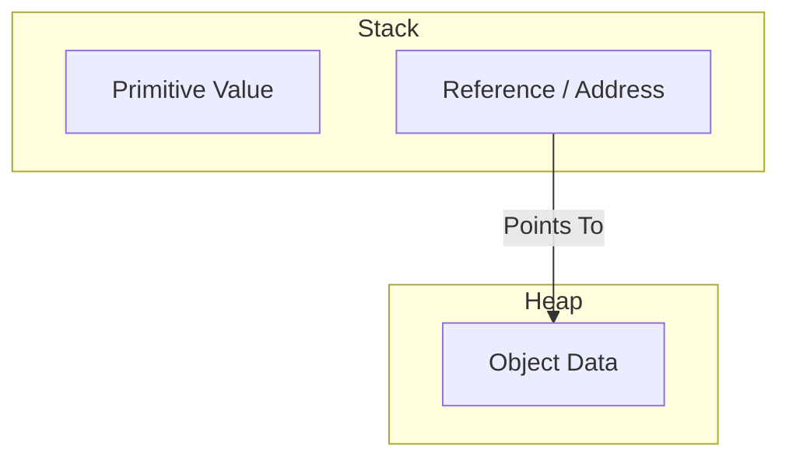

# Java Basics

## Table of Contents
- [1. Data Types & Memory Management](#1-data-types--memory-management)
    - [1.1 Primitive vs Reference Types](#11-primitive-vs-reference-types)
    - [1.2 Primitive Data Types](#12-primitive-data-types)
    - [1.3 Wrapper Classes](#13-wrapper-classes)
- [2. Type Manipulation & Variables](#2-type-manipulation--variables)
    - [2.1 Casting](#21-casting-type-conversion)
    - [2.2 Variables](#22-variables-value-vs-reference)
- [3. String Handling & Text Manipulation](#3-string-handling--text-manipulation)
    - [3.1 String Basics](#31-string-basics)
- [4. Control Flow](#4-control-flow)
    - [4.1 Math & Comparison Operators](#41-math--comparison-operators)
    - [4.2 Conditional Statements](#42-conditional-statements)
- [5. Iteration & Data Grouping](#5-iteration--data-grouping)
    - [5.1 Control Flow Loops](#51-control-flow-loops)
    - [5.2 Arrays](#52-arrays)
- [6. Packages & Imports](#6-packages--imports)
- [7. Introduction to Algorithms](#7-introduction-to-algorithms--data-structures)
    - [7.1 Algorithms](#71-algorithms)
    - [7.2 Types of Algorithms](#72-types-of-algorithms)

## 1. Data Types & Memory Management
Java categorizes data into two distinct groups based on how they are stored in memory.

- **Heap** - Where object data is stored
- **Stack** - Where primitive (non-object data) and method stacks are stored

### 1.1 Primitive vs Reference Types
| Feature | **Primitive Types** | **Reference Types** |
| :--- | :--- | :--- |
| **Definition** | Basid data types built into the language | Objects created from classes |
| **Storage** | Stored directly on the **Stack** | **Reference** is on the Stack<br>**Object** is on the Heap
| **Nullability** | Cannot be `null` | Can be `null`
| **Examples** | `int`, `double`, `boolean`, `char` | `String`, `Arrays`, `Scanner`, custom objects



### 1.2 Primitive Data Types
Java contains eight primitive types

| Category | Type | Size | Description |
| :--- | :--- | :--- | :--- |
| **Integer** | `byte`<br>`short`<br>`int`<br>`long` | 8-Bit<br>16-Bit<br>32-Bit<br>64-Bit | Whole Numbers |
| **Floating Point** | `float`<br>`double` | 32-Bit<br>64-Bit | Numbers with Fractional Parts |
| **Character** | `char` | 16-Bit | Single Unicode Character |
| **Logical** | `boolean` | Not Specified (JVM Dependent) | `true` or `false` Values |

### 1.3 Wrapper Classes
Because primitives data types are not objects, Java provides **Wrapper Classes** to allow primitives to be used in contexts that require objects.

- **Boxing** - Process of converting a primitive to its wrapper class
- **Unboxing** - Converting a wrapper class to its primitive
- **Autoboxing** - Java feature that automatically converts primitives to wrapper classes implicitly

| Primitive | Wrapper Class |
| :--- | :--- |
| `boolean` | `Boolean`
| `byte` | `Byte` |
| `short` | `Short` |
| `char` | `Character` |
| `int` | `Integer` |
| `long` | `Long` |
| `float` | `Float` |
| `double` | `Double` |

Wrapper classes have statuc helper methods like `.parse(X)` and `.valueOf()` for explicit primitive conversion.

Example:
```java
public class AutoboxingExample {
    public static void main(String[] args) {
        int n = 5;
        someMethod(n);
    }

    public static void someMethod(Integer i) {
        System.out.println(i + 3);
    }
}
```

[&uarr; Back to Table of Contents](#table-of-contents)

## 2 Type Manipulation & Variables

### 2.1 Casting (Type Conversion)
Casting the the process of converting a value from one data type to another.

- Widening Casting (Implicit / Automatic) - Converting a smaller type to a larger type size. No data loss occurs
    - `byte` &rarr; `short` &rarr; `int` &rarr; `long` &rarr; `float` &rarr; `double`
```java
int myInt = 9;
double myDouble = myInt; // Automatic Casting: 9.0
```

- Narrowing Casting (Explicit / Manual) - Converting a larger type to a smaller size. Potential data loss occurs
```java
double myDouble = 9.78d;
int myInt = (int) myDouble; // Manual Casting: 9 (Decimal Lost)
```

### 2.2 Variables (Value vs Reference)
- **Value Types (Primitives)** - Variable holds the **actual value**. When you assign `a = b`, a copy of the value is amde. Changing `a` does not affect `b`.
- **Reference Types (Objects)** - Variable holds the **memory address** (reference) of the object. When you assign `objA = objB`, both variables now point to the *same object* in memory.

```java
// Value Type (Primitive)
int a = 10;
int b = 1; // b Gets Copy of the Value 10
b = 20; // Changing b Does NOT Change a
System.out.println(a); // 10

// Reference Type (Object)
int[] arr1 = {1, 2, 3};
int[] arr2 = arr1; // arr2 Points to the SAME Memory Address as arr1
arr2[0] = 99; // Modifying arr2 ALSO Modifies arr1
System.out.println(arr1[0]); // 99
```

[&uarr; Back to Table of Contents](#table-of-contents)

## 3 String Handling & Text Manipulation
*Text manipulation requires special tools to ensure performance and efficiency.*

### 3.1 String Basics
Strings are the standard tool for representing text data in our applications. The `String` class is a collection of characters (`char` primitives).

> [!WARNING]
> **Immutability** - `String` objects are **immutable**. Once a `String` object is created, its content cannot be changed. Any "modification" (like `.toUpperCase()`) actually creates a brand new `String object in memory.

Because Strings are so commonly used, Java stores String objects in a specific way
- Strings are stored in the "string" pool portion of the **heap**
- Java only creates one object for a String value even if you make multiple references to that String

| Feature | **`String`** | **`StringBuilder`** | **`StringBuffer`**
| :--- | :--- | :--- | :--- |
| **Mutability** | **Immutable** (Cannot Change) | **Mutable** (Can Change) | **Mutable** (Can Change) |
| **Thread Safety** | **Yes** (by Virtue of Immutability) | **No** (Not Thread-Safe) | **Yes** (Thread-Safe) |
| **Performance** | Slow for Frequent Changes | **Fastest** | Slower than `StringBuilder`) |
| **Use Case** | Constant Text / Small Changes | Single-Threaded Logic / Loops | Multi-Threaded Environments |

**`StringBuilder`** Example
```java
StringBuilder sb = new StringBuilder("Hello");
sb.Append(" World");
sb.Append("!");
String result = sb.toString();
```

[&uarr; Back to Table of Contents](#table-of-contents)

## 4. Control Flow
**Control Flow** refers to the order in which individual statements, instructions, or function calls are executed.

### 4.1 Math & Comparison Operators

**1. Math (Arithmetic) Operators**
| Operator | Name | Example (`int a = 10, b = 3`) | Result |
| :--- | :--- | :--- | :--- |
| `+` | Addition | `a + b` | `13` |
| `-` | Subtraction | `a - b` | `7` |
| `*` | Multiplication | `a * b` | `30` |
| `/` | Division | `a / b` | `3` Integer Division |
| `%` | Modulo | `a % b` | `1` Remainder |

**2. Comparison (Relational) Operators**
| Operator | Name | Example |
| :--- | :--- | :--- |
| `==` | Equal to | `5 == 5` &rarr; `true` |
| `!=` | Not Equal to | `5 != 3` &rarr; `false` |
| `>` | Greater than | `5 > 10` &rarr; `false` |
| `<` | Less than | `5 < 10` &rarr; `true` |

### 4.2 Conditional Statements

**1. If-Else Statement**
```java
int age = 18;
if (age >= 18) {
    System.out.println("Adult");
} else if (age > 12) {
    System.out.println("Teenager");
} else {
    System.out.println("Child");
}
```

**2. Switch Statement**
```java
int day = 2;
switch (day) {
    case 1:
        System.out.println("Monday");
        break;
    case 2:
        System.out.println("Tuesday");
        break;
    default:
        System.out.println("Invalid Day");
}
```

[&uarr; Back to Table of Contents](#table-of-contents)

## 5 Iteration & Data Grouping

### 5.1 Control Flow Loops
| Loop Type | Mechanism | Best Use Case |
| :--- | :--- | :--- |
| **`for` loop** | Pre-determines the number of iterations | When you know exactly **how many times** to loop |
| **Enhanced `for`** | Iterates through every element in a collection | When you want to visit **every item** in an Array or List
| **`while` loop** | Checks condition **before** executing the block | When you loop until a condition changes (unknown count)
| **`do-while`** | Checks condition **after** executing the block | When the code **must run at least once** |

### 5.2 Arrays
**Array** - Container object that holds a fixed number of values of a single type.

Arrays are simple to use but come with some restrictions
- Array sizes are **immutable** - once an array is created, its size cannot be changed
- If you need a smaller or larger array, you **must** make a new oen and transfer its data to the new one
- Arrays have indexes for the elements and indexing starts at **`0`**
- Arrays maintain order of insertion - if you put something in position 2 of your array, it stays there even if you move other elements around it

[&uarr; Back to Table of Contents](#table-of-contents)

## 6 Packages & Imports
- **Packages** - Grouping of related classes (`package com.myapp.utils;`). Acts like a "folder" on your computer.
- **Imports** - Way to tell the compiler that you want to use a class located in a different package (`import java.util.Scanner;`)

[&uarr; Back to Table of Contents](#table-of-contents)

## 7 Introduction to Algorithms & Data Structures

### 7.1 Algorithms
**Algorithm** - Finite, step-by-step procedure or a set of rules to be followed in calculations or other problem-solving operations.

### 7.2 Types of Algorithms
| Type | Description | Example |
| :--- | :--- | :--- |
| **Sorting Algorithms** | Arranging data in a specific order (numerical or alphabetical) | Bubble Sort, Quick Sort, Merge Sort |
| **Searching Algorithms** | Finding a specific target within a collection of data | Linear Search, Binary Search
| **Divide & Conquer** | Breaking a complex problem into smaller, manageable sub-problems | Merge Sort |
| **Greedy Algorithms** | Making a locally optimal choice at each step to find a global optimum | Dijbstra's Shortest Path |
| **Dynamic Programming** | Solving complex problems by breaking them into overlapping sub-problems and storing results | Fibonacci Sequence Calculation

[&uarr; Back to Table of Contents](#table-of-contents)