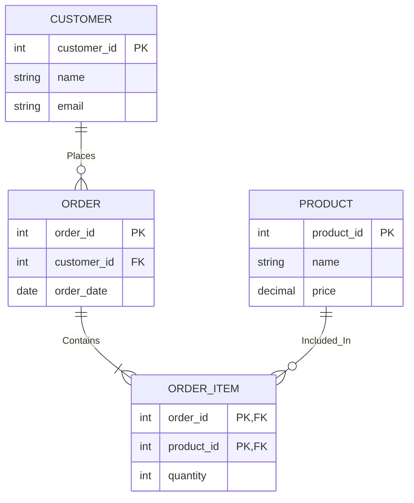

# SQL Structure & Data Modeling

## Table of Contents
- [1. High-Level Overview](#1-high-level-overview-data-modeling--erd)
- [2. The Blueprint: Schema & Table Structure](#2-the-blueprint-schema--table-structure)
- [3. The Building Blocks: SQL Data Types](#3-the-building-blocks-sql-data-types)
- [4. The Connectors: Keys](#4-the-connectors-keys)
    - [4.1 Primary & Composite Keys](#41-primary--composite-keys)
    - [4.2 Unique & Foreign Keys](#42-unique--foreign-keys)

## 1. High-Level Overview: Data Modeling & ERD
Before a single line of SQL is written, a database must be designed. This phase is known as **Date Modeling**. It is the process of defining the data requirements, the relationships between data elements, and the constraints that will govern them.

The primary tool during this phase is the **Entity-Relationship Diagram (ERD)**. An ERD is a visual representation of the database structure, allowing designers to map out complex systems before implementation.

### Core ERD Components
| Component | Description | SQL Equivalent |
| :--- | :--- | :--- |
| **Entity** | Real-World Object or Concept ("Customer", "Product") | **TABLE** |
| **Attribute** | Characteristic of an Entity ("Customer Name") | **Column** |
| **Relationship** | How Two Entities Interact ("Customer **Places** Order") | **Foreign Key** |

### ERD Visual Example: E-Commerce Relationship


### Visualizing Relationships Multiplicity
**Multiplicity** (**Cardinality**) - Describes how many instances of one entity can relate to instances of another.

- **One-to-One (1:1)** - An entity in A is related to exatly one entity in B. (User &rarr; User Profile)
- **One-to-Many (1:N)** - One entity in A can relate to many in B. (Customer &rarr; Orders)
- **Many-to-Many (M:N)** - Many entities in A can relate to many in B. (Students &rarr; Courses)

[↑ Back to Table of Contents](#table-of-contents)

## 2. The Blueprint: Schema & Table Structure

### The Schema
A **schema* is the logical container that holds the entire database structure. It defines the orginzation of tables, views, and constraints.

### Table Structure
A **table** is the fundamental unit of storage.

- **Columns (Fields)** - Vertical components that defined the data category (`email`, `created_at`)
- **Rows (Records)** - Horizontal components that represent a singel, unique instance of data (User Profile)

[↑ Back to Table of Contents](#table-of-contents)

## 3. The Building Blocks: SQL Data Types
Every column in a table must be assigned a **Data Type**. This tells the database how much storage space to allocate, what operations are allowed, and how to sort the data.

### Common SQL Data Types
| Category | Type | Description | Example |
| :--- | :--- | :--- | :--- |
| **Numeric** | `INT` | Whole Numbers | `42` |
| **Numeric** | `DECIMAL(p,s)` | Precised Fixed-Point Numbers (Money) | `19.99` |
| **Numeric** | `FLOAT` | Approximite Floating-Point Numbers | `3.14159` |
| **String** | `VARCHAR(n)` | Variable-Length Text Up to `n` Characters | `'Hello World'` |
| **String** | `TEXT` | Long-Form, Variable-Length Text | (Paragraphs)
| **Date / Time** | `DATE` | Calendar Dates (YYYY-MM-DD) | `'2023-10-27'` |
| **Date / Time** | `TIMESTAMP` | Precise Moments in Time (Includes Timezone) | `'2023-10-27 10:00:00'` |

[↑ Back to Table of Contents](#table-of-contents)

## 4. The Connectors: Keys
Keys are the mechanisms used to identify rows and establish relationships between tables.

### 4.1 Primary & Composite Keys
A **Primary Key** is the unique identifier for a record in a table. It must follow two strict rules:
1. It must be **Unique** (No two rows can have the same PK)
2. It cannot be **NULL** (Every row must have an identifer)

### Composite Key
A **Composite Key** is a Primary Key that consists of **two or mroe columns**. This is used when a single column is not sufficient to gurantee uniqueness, but a comination of columns is:

**Example Implementation**
```sql
-- Creating a Table with a Composite Primary Key
CREATE TABLE order_items (
    order_id INT,
    product_id INT,
    quantity INT,
    PRIMARY KEY (order_id, product_id) -- Combination Must be Unique
)
```

### 4.2 Unique & Foreign Keys
A **Unique Key** ensures that all values in a column are different.

**Unique vs Primary Key**
| Feature | Primary Key | Unique Key |
| :--- | :--- | :--- |
**Purpose** | Official Unique Identifer for the Row | Additional Constraint to Prevent Duplicates |
| **Nullability** | **Never** Allows `NULL` | **Allows** `NULL` |
| **Count** | Only **One** Per Table | You Can Have **Multiple** Per Table |

### Foreign Key (FK)
A **Foreign Key** is a column that creates a link between two tables. It points to the Primary Key of another table, enforcing **Referential Integrity**.

**Referential Integrity** - Ensures that you cannot have a record in a child table taht points to a non-existent record in a parent table.

**Example Implementation**
```sql
-- Creating a Table with a Foreign Key
CREATE TABLE order (
    order_id INT PRIMARY KEY,
    customer_id INT,
    order_date DATE,
    -- Linking Orders to Customers Table
    CONSTRAINT fk_customer
        FOREIGN KEY (customer_id) REFERENCES customers(customer_id)
);
```

[↑ Back to Table of Contents](#table-of-contents)