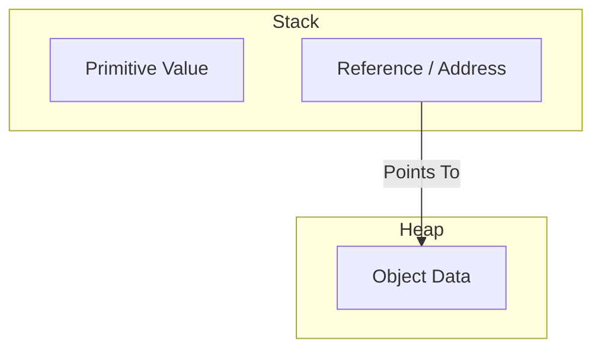

# Java Basics

## Table of Contents

## 1. Data Types & Memory Management
Java categorizes data into two distinct groups based on how they are stored in memory.

### 1.1 Primitive vs Reference Types
| Feature | **Primitive Types** | **Reference Types** |
| :--- | :--- | :--- |
| **Definition** | Basid data types built into the language | Objects created from classes |
| **Storage** | Stored directly on the **Stack** | **Reference** is on the Stack **Object** is on the Heap
| **Nullability** | Cannot be `null` | Can be `null`
| **Examples** | `int`, `double`, `boolean`, `char` | `String`, `Arrays`, `Scanner`, custom objects

### 1.2 Primitive Data Types
Java contains eight primitive types
| Category | Type | Size | Description |
| :--- | :--- | :--- | : --- |
| **Integer** | `byte` `short` `int` `long` | 8-Bit 16-Bit 32-Bit 64-Bit | Whole Numbers |
| ** Floating Point**

[&uarr; Back to Table of Contents](#table-of-contents)