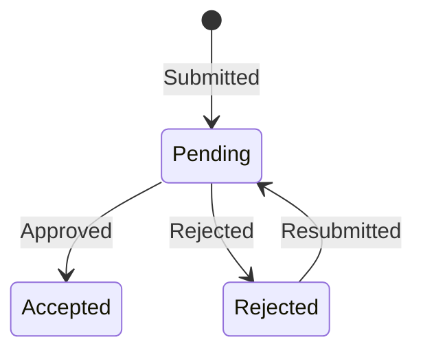

# Test Case Design

## Table of Contents
- [Test Case Design](#test-case-design)
  - [Table of Contents](#table-of-contents)
  - [1. Test Case Anatomy](#1-test-case-anatomy)
  - [2. Testing Principles to Internalize](#2-testing-principles-to-internalize)
  - [3. Happy Path \& Sad Path Testing](#3-happy-path--sad-path-testing)
  - [4. Black Box Techniques](#4-black-box-techniques)
    - [4.1 Equivalence Partitioning](#41-equivalence-partitioning)
    - [4.2 Boundary Value Analysis](#42-boundary-value-analysis)
    - [4.3 Decision Table](#43-decision-table)
    - [4.4 State Transition Diagram](#44-state-transition-diagram)
    - [4.5 Use Case Testing](#45-use-case-testing)
  - [5. Exploratory Testing](#5-exploratory-testing)

## 1. Test Case Anatomy
- Preconditions
    - Setup methods handle this
- Inputs
    - Test Data
- Actions
    - Typically the method being tested or workflow being conducted (think user story)
- Expected Results
    - What should have happened
        - If what should have happened indeed happened, your test "passes"
        - If what should have happened does not happen, your test "fails"
            - Always remember: a failing test due to an assertion that is not met means you have actually done your job as a tester: you have created a test that discovered a defect. Test fails are a *good* thing

Arrange / Act / Assert

[&uarr; Return to Table of Contents](#table-of-contents)

## 2. Testing Principles to Internalize
1. Testing reveals defects, not their absence
2. Exhaustive testing is impossible
3. Test early
4. Defects cluster
5. Tests wear out
    - Pesticide paradox
6. Testing is contextual
7. Absence of error fallacy

[&uarr; Return to Table of Contents](#table-of-contents)

## 3. Happy Path & Sad Path Testing
**Happy Path** (Positive) Testing is testing done with valid inputs (test data and actions performed).
- Valid = Conforms to any / all requirements

**Sad Path** (Negative) Testing is testing done with invald inputs (test data and actions performed).
- Invalid = Does not conform to one or more requirements

[&uarr; Return to Table of Contents](#table-of-contents)

## 4. Black Box Techniques
**Black Box Techniques** do not require or expect the tester to have access to the underlying systems being tested. This would be the source code of the application - the code is not considered during test creation. This makes these techniques particularly useful for Systems and Acceptance level tests, but they can still be used if you take the underlying system into consideration. Tests and their data are performed through analysis of documentation, requirements, and stakeholder expectations.

### 4.1 Equivalence Partitioning
Consider a registration feature and one of the requirements for new accounts is that they must have a username, and that username must have lowercase, uppercase, and numeric characters (at least one of each). At a minimum, we need at least two usernames for our test data: one representing a "valid" username, and one representing an "invalid" username.
- Valid Username = `Use3r`
- Invalid Username = `My_username`

We can use the two usernames above to each represent their entire "class" of data. "`Use3r`" can be our representative of all valid username inputs, and "`My_username`" will be the representative of all invalid usernames. If our positive test passes with our valid username, we assume it will still pass if we provide any other value that would be considered valid by the requirement. Likewise, if our test with the invalid data passes, we assume that any invalid test data we provide that fits in the category would similarly still pass.

### 4.2 Boundary Value Analysis
**Equivalence Partitioning** is a good choice when your requirements do not have hard boundaries. When a requirement does have a hard boundary, (usernames must be 5-15 characters), **Boundary Value Analysis** becomes a good choice for organizing your test data. Any time you have these types of boundaries, your defects will typically we on the "edges" of those boundaries. Boundary Value Analysis is organizing your test data so that your tests ensure your requirement are enforced at the boundary. If the boundaries have the business rules enforced, you can safely assumy any values within the boundary are also enforced.
- Just outside the lower boundary = "`Use3`"
- Just inside the lower boundary = "`Use33`"
- Just inside the upper boundary = "`UserNameGood123`"
- Just outside the upper boundary = "`UsernameBad12345`"

These are a few more test inputs than when we just did Equivalence Partitioning, but each test provides us with meaningful, non-redundant information. This is the benefit of Equivalence Partitioning and Boundary Value Analysis: by allowing single value to represent all possible values within their class, we strike a good balance between test coverage while minimizing the number of tests we actually have to build / run.

### 4.3 Decision Table
Once you have your test data, that data must be organized. A simple way to organize your data ane make sure that you have sufficient coverage for your requirements is to organize your data in a decision table.
| Username | Password | Expected Outcome |
| ---- | ---- | ---- |
| Valid | Valid | User Registered |
| Invalid | Valid | User Not Registered |

| Username | Password | Expected Outcome |
| :--- | :--- | :--- |
| Use3 | Valid | User Not Registered |
| Use3 | Invalid | User Not Registered |
| Use33 | Valid | User Registered |
| Etc... | Etc... | Etc... |

The benefit of organizing your test data into one or more decision tables is it provides a quick snapshot of how many tests you are going to need to build, and a quick view of what the results of those tests should be. All rows with only positive data are going to be your happy path tests. Any row that has one or more invalid pieces of test data are going to be your sad path tests.

### 4.4 State Transition Diagram
Creating a **State Transition Diagram** when your test involves moving a resource between pre-defined states; the diagram itself is a nice visual aid in helping you to determine what you test flows will look like. Below is an example state transition diagram for a theoretical reimbursement request.

Once we have visualized our flows, we can start crafting out scenarios. A decision table is quite useful here.
| Starting State | Action | Expected New State |
| :--- | :--- | :--- |
| Not Yet Made | Submit | Pending |
| Pending | Approve | Accepted |
| Rejected | Approve | Remain in Rejected State |
| Etc... | Etc... | Etc... |

### 4.5 Use Case Testing
The other techniques we have looked at help us narrow data and / or create logical boundaries for the testing work we do. The user stories and requirements you work with will not always fit into neat little packages: sometimes your requirement will be broad, sometimes your user stories will be abstract, and you will have to make some assumptions with your testing. In these scenarios, organizing your tests into "use cases" is a good approach. Use case testing is thinking of "real world scenarios" for your test object and then validating those scenarios happen as expected.

Consider you are testing a bank ATM and its software. The bank has simply told you "users should be able to withdraw their money and deposit cash into their account". With this broad user story, we can organize our testing by creating "use cases".
- Main Happy Path: User accesses their account and deposits some money
    - Preconditions: User has an account, user has cash to deposit
    - Input: Debit card attached to account, the cash to deposit
    - Action:
        - User enters debit card into ATM and provides PIN
        - User selects deposit option
        - User provides cash
    - Expected Outcome:
        - Money is deposited and card returned to the user

If we had more requirements or any kind of information, we could use the other testing techniques to better organize our test data, but when all else fails, you can always fall back on user experience with a product / service in order to consider "use cases" and build your test cases around those use cases.

[&uarr; Return to Table of Contents](#table-of-contents)

## 5. Exploratory Testing
The types of test techniques and strategies we have looked at all have a general assumption that you have a decent amount of test basis to work off. This will not always be the case - sometimes you will have to creates tests with very little to go off. In these cases, you can use your experience as a user and tester to craft tests that you are confident will provide meaningful information when run.
- In a black box scenario, this is called "Error Guess Testing"
- In a white box scenario, this is called "Exploratory Guessing"

These are technical terms provided for a non-technical process - it's essentially making it up as you go, but ideally you use your personal experience and understanding of the software being tested to create the most beneficial tests you can think of.

[&uarr; Return to Table of Contents](#table-of-contents)